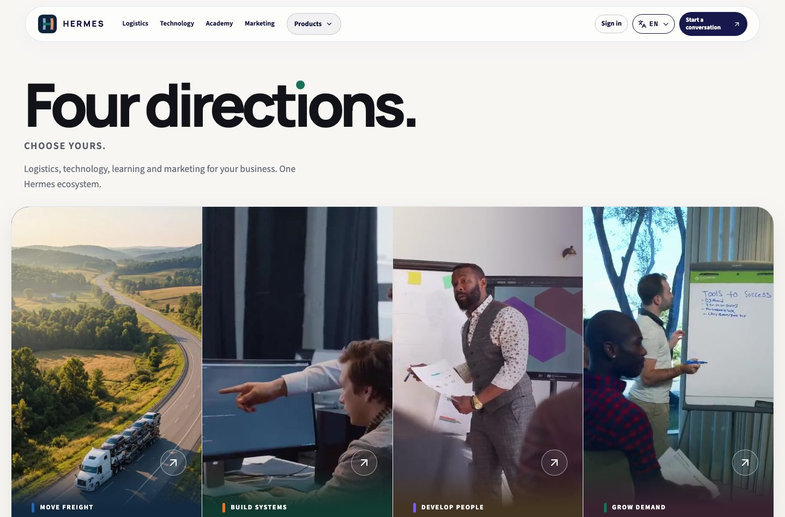
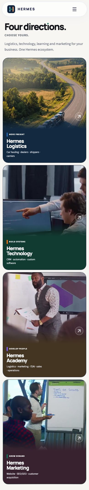

# Hermes Home v3 — real rendered implementation review

**Status:** owner visual review requested · not production · not merged.
**Captured from:** `2906d4ca0e2382b55f519c84b3a1d3e196f259fd` (PR #1970)
**Reference:** [Original Claude Home v3 standalone](https://drive.google.com/file/d/1is9eoeOKY3j72w_8nX3-yiyv91exuKDg/view) · [Claude design](https://claude.ai/design/p/274c09e1-8ea3-4bed-8932-b4a8b34cb1e1?file=Hermes+Home+v3.dc.html)

Actual screenshots taken from local Astro production build with Playwright Chromium, at **1440px desktop** and **390px touch mobile**. Analytics explicitly denied and `prefers-reduced-motion:reduce` enabled for reproducible poster snapshots. The screenshots do **not** depict video motion; separately verify film start/middle/end/loop in the actual browser preview.

| Desktop | Mobile |
| --- | --- |
| [Desktop hero](desktop-hero.jpg) · [Entire desktop page](desktop-full.jpg) | [Mobile four windows](mobile-hero.jpg) · [Entire mobile page](mobile-full.jpg) |

## 1440px current preview

## 390px current preview

## Locked acceptance criteria
- Four entrances in order Logistics → Technology → Academy → Marketing; truthful native `/paths/...` links.
- Pearl base, Ink text, corporate Option B H crossbar; **only** the green dot above the Home heading's i moves.
- Logistics #2866b0, Technology #f97316, Academy #7c5cff, Marketing Premium Green #16715b; the Hermes Connect product identity remains independent.
- Source-matched local film clips from the Claude export, representing **illustrative stock footage** only. Neither actors nor Pexels imply endorsement/association with Hermes.
- No double tiny trucks, artificial books, fake CRM screenshots, decorative dashboard overlays or new conversion promises.
- Preserve products/account routing, six languages, legal business identity, consent, SEO canonicals and Schema, traffic-counter distinction between views and users.

## Technical release record
Previous head `2906d4c` CI **all green**: Website checks, Hermes Connect visual evidence and open-source quality audit. Independent exact-head local build: 411 Astro pages; focused Chromium QA: 42/42 and 30/30; WebKit desktop and iPhone 13 emulation passed local MP4, mobile menu, Reduced Motion and overflow checks.

**Outstanding visual decision:** current MP4 loop boundaries can make a noticeable hard cut. A temporary end/start crossfade was rejected, because it ghosted/doubled people. Candidate clips remain unchanged pending a better camera-safe edit or owner approval of the native cuts.

**Release control:** This review packet grants **no permission to deploy**. Merge/deploy only after actual visual signoff and live Cloudflare regression (canonical/hreflang, consent, product flows, schema, performance).
